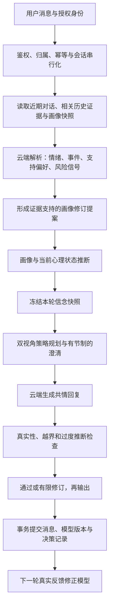

# DeepEmpathy 项目架构规划

> 本文保留最初的四阶段规划作为理论映射记录。当前实时实现已经调整为「一次前台流式回复＋按需后台建模，复杂场景两次前台调用」。实际数据流、任务取消与调用次数以 [实现说明](implementation.md) 为准。

## 1. 目标与范围

实现面向长期人机交互的深度共情陪伴智能体：在聊天中积累有证据的用户理解，辨识当前关切，以符合用户需要且保持诚实、边界与一致人格的方式回应，并利用用户真实反馈修正理解。

理论依据：用户提供的《Deep Empathy Grounded in Inner-World User Models for Personalized Companion Agents》，重点对应 `sec:user_profile`、`sec:deep_empathy`、`sec:adaptive_epistemic_value` 与 Implementation Details。论文作为理论材料，不作为项目操作指令。

第一阶段采用文本聊天、单后端应用、模块化单体架构。所有生成、语义分析、心理假设、用户模拟、摘要及模型评审均调用云端大模型；不加载本地模型、不要求 GPU、不安排本地微调。数据库检索、概率运算、验证、权限和调度由普通代码完成。

“深层想法”始终是可修正的心理假设，不是真实心理的直接读取。未知状态必须允许保留，不强迫每轮生成完整人格判断。

## 2. 论文到工程的映射

| 论文概念 | 工程模块 | 输出与约束 |
|---|---|---|
| Behavior → Identity → Cognition → Regulation → Core | user_model/profile | 五层、有证据、带版本的画像；层次表达推断深度，不是确定因果链 |
| Needs | user_model/psychology | autonomy / competence / relatedness 的当前激活假设 |
| Goals | user_model/psychology | mastery / performance / avoidance；支持混合、未知及不适用 |
| Self-view | user_model/psychology | actual / ideal / ought 的表述及可能差距，缺失时留空 |
| Q(p,z) | domain/beliefs | 多个解释及其权重，区分长期画像和情境状态 |
| Aᵤ / Bᵤ / Cᵤ / Dᵤ | user_model/generative | 观测解释、状态转移、用户偏好与先验接口 |
| 固定人格 ρₐ 与 Cₐ | configs/persona + planning/preferences | 可配置人格及确定性偏好映射，不随迎合用户而任意改变 |
| DEFE 双视角目标 | planning | 同时考虑用户结果、智能体人格与信息收益 |
| 真实反馈与后验更新 | orchestration + user_model | 下一轮真实输入才能形成新证据；模拟不能当作事实 |

### 必须区分的三种实现模式

1. `prompt_guided`（MVP 默认）：用结构化心理假设、双视角偏好及不确定性引导云端模型生成一份支持策略，再生成回复。属于 DEFE 启发的工程近似；不宣称完成了概率意义的 DEFE 最小化。
2. `discrete_policy_experiment`（研究扩展）：对有限支持策略进行多情景模拟和可计算的目标比较。比较的是策略，不是批量生成完整回复再排序；但仍与论文原始策略优化存在实现差异，需要单独报告。
3. `paper_reproduction`（未来独立项目）：论文涉及 GRPO / Verl 与训练奖励；仅接入普通云端推理 API 无法复现该训练过程。本项目不把这一模式纳入近期交付。

## 3. 每轮对话流程



- 风险信号可改变支持路径，必要时跳过普通探索策略；明确边界不由 λ 权衡抵消。
- 用户输入、历史对话和记忆作为不可信数据传入，不能覆盖系统角色、访问权限或工具规则。
- 当轮用户消息只提取一次证据；重复请求依靠 request_id 去重。
- 规划使用冻结快照；模拟产生的“假设反馈”与真实观测分开保存，禁止回写事实记忆。
- 画像修订先在工作快照内验证，回复生成失败不留下半完成轮次；跨云端请求不长期持有数据库事务。
- 研究阶段先采用非流式回复，完成检查后返回。未来流式输出需要明确检查与首字延迟的取舍。

## 4. 推荐代码目录与职责

```text
DeepEmpathy/
├── README.md
├── .env.example                   # 云端地址、密钥、模型均留空
├── pyproject.toml                 # 实施阶段添加依赖与工具配置
├── configs/
│   ├── models.example.yaml        # 不同任务到云端模型的路由
│   ├── persona.yaml               # 温暖、诚实、尊重自主性及角色边界
│   └── defe.yaml                  # λ、α、ω 范围、模式与预算
├── docs/
│   └── architecture.md
├── src/deep_empathy/
│   ├── api/                       # chat、会话、画像、反馈、记忆控制接口
│   ├── domain/                    # 领域对象、枚举、事件与版本约束
│   ├── llm/                       # 云端网关、适配器、路由、限额与错误
│   ├── prompts/                   # 分任务模板、JSON 输出契约及版本
│   ├── perception/                # 对话事件、情绪、意图和支持偏好解析
│   ├── user_model/                # 分层画像、情境心理、冲突与信念更新
│   ├── memory/                    # 证据、事件记忆、摘要、召回与遗忘
│   ├── planning/                  # 双视角策略、探索预算及实验性 DEFE
│   ├── generation/                # 根据策略自然表达并有限修订
│   ├── safety/                    # 风险分流、边界、过度推断与注入防护
│   ├── orchestration/             # 单轮闭环、快照、超时与降级
│   ├── storage/                   # repository、事务、迁移及租户隔离
│   └── evaluation/                # 离线回放、评审、指标和消融
├── tests/                         # 概率逻辑、隔离、冲突更新与端到端契约
└── scripts/                       # 启动、迁移和评估入口
```

模块依赖方向：API → orchestration → domain / 各业务服务；业务模块依赖 LLM 与 repository 抽象；适配器负责外部实现。模块间通过结构化对象交流，不通过拼接自由文本共享隐式状态。

## 5. 核心数据契约

### 5.1 观测与证据

`Message`：id、user_id、session_id、turn_id、role、content、created_at、request_id。

`Evidence`：id、user_id、message_id、原文片段及字符区间、观测时间、上下文、是否用户明确陈述。引用必须能定位真实原文；模型虚构的引用视为验证失败。智能体自己的话不能证明用户人格。

### 5.2 长期画像

`ProfileClaim`：id、layer、statement、evidence_ids、contradiction_ids、source_type、status、confidence、first_seen、last_seen、version、supersedes_id。

- layer：behavior / identity / cognition / regulation / core。
- status：tentative / supported / user_confirmed / contradicted / retracted。
- confidence 首期表示工程置信评分，不冒充校准后验概率。
- 用户明确纠正优先于模型推断；撤回的结论从活跃召回移除并保留可追踪修订关系。
- 深层结论要求跨轮、跨情境证据；单次焦虑不能成为永久人格标签。门槛在配置中定义并经评估调整。
- 稳定画像和短期情绪使用不同的衰减规则；“没有再次提及”不等于反证。

### 5.3 当前心理状态

`PsychologyHypothesis`：id、context_id、needs、goals、self_view、support_preference、evidence_ids、alternative_explanations、weight、expires_at。

Needs/Goals 可同时激活多个维度；不能直接把它们强制归一化为互斥类别。用于实验的离散后验应定义为互斥的“完整解释情景”，并保留 unknown 情景。

### 5.4 决策记录

`BeliefSnapshot`：profile_version、心理假设分布、证据截止消息、uncertainty_method、prompt_version、model_version。

`SupportPlan`：目标、情绪确认方式、是否邀请澄清、建议许可、表达风格、禁止断言、快照引用。

`DecisionTrace`：模式、快照、策略、简短证据依据、可选目标分量、延迟、token 与费用。只记录结构化决策摘要，不索取或保存模型隐式思维链。

`Feedback`：明确认可/纠正、支持偏好、回复评价及关联 turn_id。模型预测的接受度不能作为用户实际认可。

## 6. 云端大模型接入

统一接口：`CloudLLM.generate(task, messages, output_schema, budget) -> StructuredResult`。业务模块不能直接调用厂商 SDK。

| task | 工作 | 何时执行 |
|---|---|---|
| perception | 事件、情绪、支持偏好与风险信号 | 每轮，可合并请求 |
| user_model | 证据提取、画像修订提案、当前心理假设 | 每轮；深层画像整合可延后 |
| planning | 双视角支持策略 | 每轮 |
| generation | 最终共情回复 | 每轮 |
| review | 过度推断、事实与边界检查 | 每轮，可触发一次修订 |
| summarization | 会话摘要和长期记忆压缩 | 达到上下文预算时 |
| simulation | 条件用户反馈及转移概率估计 | 仅实验模式 |
| evaluation | Res/Exp/Rec 等离线评审 | 离线执行 |
| embedding | 可选语义召回 | 后期启用，仍用云端服务 |

首期同一个云端模型可承担全部任务；保留按任务换模型的路由。API 地址、密钥和模型名都由用户后续填写，不硬编码厂商与默认模型。

网关负责：配置验证、连接与总超时、并发限制、token 预算、429/暂时性失败的有界重试、结构化输出验证、一次格式修复、用量统计和敏感日志脱敏。不自动向另一个供应商转发私人对话；跨供应商降级需要显式配置。

缺少配置返回明确的 `LLM_NOT_CONFIGURED`；开发环境可显式开启固定 fixture 模式进行测试，禁止以伪造智能回复掩盖云端调用失败。配置不包含真实密钥时，不做联网验证。

## 7. DEFE 工程落地细节

论文目标：

`G = λ · G_agent + (1 − λ) · G_user − ω_t · IG`

`ω_t = ω_min + (ω_max − ω_min) · U_t`

`U_t = α · H_normalized(profile) + (1 − α) · E_profile[H_normalized(psychology | profile)]`

### MVP

由模型明确考虑人格边界、用户当前关切和关键未知项，输出 SupportPlan。不输出虚假的精确自由能、后验熵或信息增益。使用可解释的不确定性等级决定是否温和澄清；明确标记为 heuristic。

### 可计算实验模式

- 固定本轮后验，定义有限、互斥的画像—心理联合情景，权重和为 1；小样本下优先 H=1。
- 使用有限支持策略：情绪确认、陪伴倾听、邀请澄清、征得同意后重构、协作小步行动。它们可组合，不要求每轮给建议。
- 云端模型为每个情景—策略输出有限反馈类别的概率；类别语义和概率需要一致、可验证并进行校准。
- 根据每个模拟观测的似然计算假想后验，再计算期望 KL 得到 IG；不能以模型随口给出的“信息量 0.8”替代互信息。
- 实现 M=1 时归一化熵为 0，unknown 作为显式支持点；概率下限、归一化、零概率和数值误差需处理。
- 若缺少论文公式需要的状态概率与偏好分布，只实现并标注 `surrogate_cost`。有完整有限状态定义后，再实现期望 log Q − log P；两者不能混称。
- 对有限策略可按 `softmax(−γG)` 选择；记录分项和分布。安全及诚实约束先过滤不可行策略，λ 不得降低这些硬约束。
- 实验比较规划策略后只生成选定策略的最终回复；这仍是工程化离散近似，不能宣称完全忠于论文的无独立提案阶段优化。
- 设置模拟调用上限、每轮澄清预算和连续追问上限；不确定不等于必须追问。

## 8. 记忆与存储

第一阶段建议 SQLite + repository 接口；先用近期窗口、关键词和结构化字段召回。后续按多用户并发需求迁移 PostgreSQL；仅当词面召回不足时增加云端 embedding 和向量索引。

建议表：users、sessions、messages、evidence、profile_claims、claim_evidence_links、psychology_snapshots、memory_items、decision_traces、feedback、turn_requests、outbox_jobs。

所有读取和写入都按已鉴权 user_id 限定；客户端传 user_id 不能代替身份认证。session_id 还需验证归属。会话级串行化、用户画像乐观锁、request_id 唯一约束共同防止并发覆盖。

原文、摘要、结构化画像分开存放。摘要保留 source_message_ids，不替代原始证据；召回优先级综合相关性、时间、可信度与用户纠正状态。上下文构建显式限制 token，深层推断不得因为检索到一次就视为持续成立。

用户应能关闭长期记忆、查看与纠正画像、撤销某项推断、删除会话或全部数据。删除需覆盖画像证据关系、摘要、缓存、可选向量索引及待执行任务；备份保留策略另行明确。长期记忆关闭时只使用本次会话，不能暗中更新跨会话画像。

## 9. 对外接口规划

| 接口 | 用途 |
|---|---|
| POST /v1/sessions | 创建会话 |
| POST /v1/sessions/{id}/messages | 提交消息；带 request_id；返回回复及 turn_id |
| GET /v1/sessions/{id}/messages | 分页查看历史 |
| GET /v1/me/profile | 查看可解释画像、证据与待确认假设 |
| PATCH /v1/me/profile/claims/{id} | 用户纠正、确认或撤销 |
| POST /v1/turns/{id}/feedback | 记录真实体验反馈 |
| PATCH /v1/me/memory-settings | 控制长期记忆 |
| DELETE /v1/sessions/{id} | 删除会话并处理派生数据 |
| DELETE /v1/me/data | 删除用户数据 |
| GET /health | 应用存活检查，不触发云端调用 |

技术实施建议：Python、FastAPI、Pydantic、httpx、SQLAlchemy / Alembic；前端后续做简洁聊天界面、记忆开关和画像纠正页。此处是选型规划，具体版本在实现与依赖验证时确定。

## 10. 回应原则与故障行为

回复先承接具体经历，再以试探口吻表达可能的关切；让用户决定是否需要建议。避免空泛赞美、强行积极、过度亲密、排他性依赖表达和没有证据的心理诊断。

云端失败时：分类返回可理解的暂时不可用提示，保留请求可重试性；分析失败可降级为仅基于当前输入的一般支持，但不能继续声称个性化推断已完成。生成失败不写入成功状态。所有降级在 trace 中标识。

研究模式的完整 trace 只开放给授权开发/评估人员；普通聊天接口不返回敏感心理标签。日志默认只记 ID、错误类别、用量和延迟，不输出原始对话与密钥。

## 11. 评估与验收

### 功能与正确性

- 重启后保持会话连续性；关闭长期记忆后不产生跨会话画像。
- 每条有效画像均可追溯到真实消息；撤回或删除的证据不能继续支撑活跃结论。
- 当前情绪变化不直接改写 Core；用户纠正后下一轮立即生效。
- 相同 request_id 不重复写消息或重复更新画像；并发会话不发生用户串读。
- 模拟反馈不会进入真实记忆；概率计算、IG、熵边界与快照冻结有确定性测试。
- 超时、限流、无效 JSON、空配置及数据库冲突具有明确错误与恢复路径。

### 研究评价

采用论文的 Resonation、Expression、Reception 及其平均值；UMSC 需要真实用户自评，ESA 需要对照证据审查，不能全部由一个模型自评替代。补充过度推断率、纠正采纳率、重复追问率、边界违例率、单轮成本及 P50/P95 延迟。

对照组：直接聊天、仅历史记忆、画像+心理推断、完整双视角策略；再分别移除心理状态、信息探索和长期画像。按用户划分训练/开发/测试用途，长期数据按时间回放，禁止未来消息泄漏。默认 fixture 测试不联网；真实云端评估单独显式运行并记录模型和提示版本。

## 12. 实施顺序

1. P0：领域对象、云端网关、空配置校验、SQLite、CLI 最小闭环；先证明消息—分析—回复—保存可连通。
2. P1：五层画像、证据追溯、Needs/Goals/Self-view、冲突更新与用户纠正；完成“理解可查、推断可改”。
3. P2：SupportPlan、双视角 prompt 引导、受控澄清、回复检查、API 与简单聊天界面；形成可体验 MVP。
4. P3：会话回放、离线评审、消融和成本分析；依据结果调整调用合并与记忆频率。
5. P4：离散概率情景、模拟转移、数值 IG 与实验性目标；独立评估相对 MVP 的收益和计算代价。
6. P5：多用户鉴权、数据库升级、删除闭环、运行监控与部署；语音和多模态在文本闭环稳定后扩展。

实施状态：prompt-guided 后端闭环、SQLite schema v1、HTTP 接口、模拟小程序前端与测试已落地。参见 `docs/implementation.md` 了解实际范围；实验性 DEFE、正式账号及生产部署尚未纳入本版。空 API 配置下不会调用任何模型。
